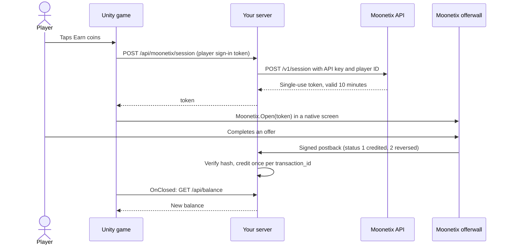

# Moonetix offerwall: Unity example

**A Unity game that opens the Moonetix offerwall in a native screen and shows a coin balance your server owns.**

[](https://github.com/moonetix/offerwall-unity-example/actions/workflows/ci.yml)
[](https://moonetix.com)
[](LICENSE)
[](https://docs.moonetix.com/unity-sdk)
[](https://moonetix.com/register?from=github-offerwall-unity-example)
[](https://moonetix.com/integrations/unity)
[](server/)

Two halves: a small Unity project with the [Moonetix](https://moonetix.com) plugin `com.moonetix.offerwall` 2.0.0, and a Node.js server that creates offerwall sessions, credits coins from postbacks and returns the balance. Moonetix is a pay-per-result affiliate network. Players complete offers and earn your coins; you are paid per completed offer.

> **Get your App ID and keys: sign up free at https://moonetix.com/register?from=github-offerwall-unity-example**

## What you get

1. **No key in the build.** The game gets a single-use session token from your server. The API key and the postback key never leave the server, so nothing in an unpacked APK or IPA opens the offerwall as another player.
2. **A balance players can trust.** Coins are added only from signed postbacks, each `transaction_id` once. A reversal takes back exactly what was credited. The HUD only reads the balance.
3. **The whole loop in one place.** Earn button, coin HUD that reloads when the offerwall closes, age check, token endpoint and postback handler. The server has 21 tests against real Moonetix postbacks.

## Request flow



## Quick start

You need Node.js 22.13 or later, Unity 2022.3 LTS or Unity 6, and an approved Moonetix app.

**1. Start the server**

```bash
git clone https://github.com/moonetix/offerwall-unity-example.git
cd offerwall-unity-example/server
cp .env.example .env      # put your API key and postback secret key in .env
npm start                 # listens on PORT (default 3000)
```

| Variable | Required | Default | Purpose |
| --- | --- | --- | --- |
| `MOONETIX_API_KEY` | yes | | API key from the API page of your dashboard. Server only. |
| `MOONETIX_POSTBACK_KEY` | yes | | Postback secret key from the Postback page. Server only. |
| `PORT` | no | `3000` | HTTP port |
| `DATABASE_PATH` | no | `./data.sqlite` | SQLite file for players, balances and transactions |
| `CURRENCY_NAME` | no | `Coins` | Currency label returned by `/api/balance` |

In Unity, the Inspector holds the rest: **App Id** on `EarnButton` (default `YOUR_APP_ID`) and **Server Url** on `PlayerAccount` (default `http://127.0.0.1:3000`).

Put the server behind https and save this postback URL on the Postback page:

```text
https://YOUR_HOST/moonetix/postback?user={user_id}&tx={transaction_id}&event={event_id}&status={status}&reward={reward}&payout={payout}&offer={offer_name}&hash={hash}
```

**2. Open the Unity project**

1. In Unity Hub, choose Add, Add project from disk, and pick the `unity/` folder. The Package Manager installs `com.moonetix.offerwall` 2.0.0 from the Moonetix registry in [`unity/Packages/manifest.json`](unity/Packages/manifest.json).
2. In any scene, create an empty GameObject and add `PlayerAccount`, `EarnButton` and `CoinHud`.
3. On `EarnButton`, set **App Id** to the App ID from the top of your offerwall's settings page. It is 24 characters. It is not the API key.
4. Drag the `PlayerAccount` component into the **Account** fields of `EarnButton` and `CoinHud`, and `EarnButton` into **Earn Button** of `CoinHud`.
5. On `PlayerAccount`, set **Server Url** to your server, with https.
6. Build for Android or iOS (Target minimum iOS Version 13.0) and run on a device.

Unity refuses plain `http://` downloads by default, and so do Android and iOS. Use an https URL for device builds. In the Editor the offerwall does not open: `Moonetix.IsSupported` is false, and the HUD says so.

Already have a project? Copy `unity/Assets/MoonetixDemo/` and add the `scopedRegistries` entry and `com.moonetix.offerwall` from the manifest to your own `Packages/manifest.json`.

## What happens on a tap

1. On first launch, `CoinHud` asks the player to confirm they are 16 or older. `PlayerAccount` then creates a guest player on your server and keeps only a random sign-in token in `PlayerPrefs`.
2. The player taps Earn coins. `EarnButton` posts to `/api/moonetix/session` with that sign-in token.
3. The server finds the player from the token, never from a field the game sends, and calls `POST https://api.moonetix.com/v1/session` with the API key and the player ID. It returns only the token.
4. `EarnButton` calls `Moonetix.Open(token)`. A token works once and for 10 minutes, so it is used right away and never stored.
5. The player completes an offer. Moonetix calls `/moonetix/postback`. The server checks the hash first, credits status 1 once per `transaction_id`, takes the stored amount back on status 2, and answers 200 only after the change is saved.
6. When the player closes the offerwall, `Moonetix.OnClosed` fires and `CoinHud` reloads the balance. It also reloads when the game resumes, because some offers credit minutes later.

| Path | Purpose |
| --- | --- |
| `unity/Packages/manifest.json` | Moonetix scoped registry and the plugin |
| `unity/Assets/MoonetixDemo/EarnButton.cs` | `Moonetix.Init`, token request, `Moonetix.Open`, `OnError` |
| `unity/Assets/MoonetixDemo/CoinHud.cs` | Balance, Earn button, age check, reload on `OnClosed` |
| `unity/Assets/MoonetixDemo/PlayerAccount.cs` | Demo sign-in. Replace with your own accounts. |
| `server/src/session.js` | `POST /v1/session` call |
| `server/src/postback.js` | Postback handler |
| `server/src/store.js` | SQLite players, balances, transactions |
| `server/src/server.js` | HTTP routes |

The guest sign-in is only here so the example runs on its own. In your game, let the server take the player from your existing login, and use the same account ID that your wallet uses. Do not use a device ID: it changes on reinstall.

## Security

- The API key and the postback secret key are read from environment variables on the server. Never put them in the game, a ScriptableObject, or Git. Anyone can read a game's files.
- The session and the balance belong to the player of the sign-in token. A user ID the game sends is ignored.
- The postback hash is checked with a constant-time comparison before anything else. A missing hash gets 400, a wrong one 403.
- `transaction_id` is the primary key of the transactions table, so a retry cannot credit twice. The credit and the balance change run in one database transaction.
- A reversal subtracts the stored amount, only for a transaction that was credited to the same player. Balances can go below zero after a reversal; say in your terms that rewards can be taken back.
- Credit only from the postback. `OnClosed` and other plugin events can be faked on a player's device.
- If Moonetix answers 403 (`app_not_live`, `user_blocked`), the server answers 403 and the game shows that offers are not available.
- Only a SHA-256 hash of each sign-in token is stored. Amounts are integers in millionths of a coin, so `0.375` adds up exactly.

## Store and platform rules

- **Steam:** Valve does not support advertising models in Steam games and asks developers not to reward players for engaging with ads. Keep the offerwall out of Steam builds. See [Can you put ads in a Steam game?](https://moonetix.com/academy/monetization/ads-in-steam-games)
- **Console stores** have their own certification rules. Check them before you ship an earn screen.
- **Web game portals** such as CrazyGames and Poki allow only their own ad SDK in the build you give them. See [Best offerwall for HTML5 and web games](https://moonetix.com/academy/monetization/best-offerwall-for-web-games).
- **Google Play and the App Store:** never reward ratings or reviews, and keep the offerwall optional. Add User ID, Device ID, Coarse Location and Product Interaction to your privacy forms, as the [Unity SDK docs](https://docs.moonetix.com/unity-sdk#privacy) list.
- Rewards are only for completed offers, never for invites, likes, reviews or other engagement. Players must be 16 or older, with a parent's permission under 18.

The plugin runs on Android and iOS only. For desktop or WebGL builds outside Steam, use the signed offerwall link, as shown in [offerwall-godot](https://github.com/moonetix/offerwall-godot) and Path B of the [Unity guide](https://moonetix.com/academy/integrations/unity-offerwall).

## Running the tests

```bash
cd server
npm test
```

The tests need no keys and no network. They start the server with an in-memory database and a local stand-in for `POST /v1/session`, and check:

- that a player is created only after the 16+ confirmation, and that only a hash of the sign-in token is stored;
- that the session call sends the API key and the server's player ID, ignores a `user_id` from the game, returns only the token, and maps 403 to 403 and other failures to 503;
- real postbacks produced by the Moonetix postback code (`server/test/fixtures/moonetix-vectors.json`): credit, retry, the same credit 10 times at once, decimal rewards, reversal, repeated reversal, a credit after its reversal, a reversal for another player, a `test_` reversal that was never credited, unknown players, tampered, wrongly signed and unsigned postbacks, and a storage failure that answers 500.

The test values are fake: app ID `demoapp0000000000000001`, postback key `test_postback_key_not_secret`. The C# scripts are not compiled by these tests. Open the project in Unity to build them.

To check the running server from the outside, create a player (run the game once, or `curl -X POST http://127.0.0.1:3000/api/players -H 'Content-Type: application/json' -d '{"age_confirmed":true}'`) and run [postback-tester](https://github.com/moonetix/postback-tester). It signs postbacks the way Moonetix does and sends a credit and its retry, three kinds of reversal, four forged or unsigned postbacks and five parallel copies of one credit:

```bash
export MOONETIX_POSTBACK_KEY=your-postback-secret-key   # same value as in server/.env
npx github:moonetix/postback-tester --preset moonetix \
  'http://127.0.0.1:3000/moonetix/postback?user={user_id}&tx={transaction_id}&event={event_id}&status={status}&reward={reward}&payout={payout}&offer={offer_name}&hash={hash}' --user 1
```

## End-to-end check with Moonetix

1. Run the game on a device and confirm the age check. The HUD shows your player ID, 1 on a fresh database.
2. Tap Earn coins. The offerwall opens in a native screen. Check that an offer opens in the store or the browser and that back and close work.
3. In the dashboard, open Offerwalls, your offerwall, Integration. Under Integration status, click **Send a test postback** with user ID `1` and status 1. You can also send one from the Postback page.
4. Close the offerwall or return to the game. The balance goes up once. Every attempt and your server's answer is listed under Reports, Postbacks.
5. A status 2 test gets a new `test_` transaction ID that was never credited, so the server answers 200 and changes nothing.
6. Test on a normal home or mobile connection. On a VPN or a cloud test device the offerwall shows a block page.
7. Before launch, remove the test rewards from your test account.

## Troubleshooting

| What you see | Why, and the fix |
| --- | --- |
| "The offerwall opens only in Android and iOS builds." | `Moonetix.IsSupported` is false in the Editor, on desktop and in WebGL. Build for a device. |
| "Could not reach the game server. Try again later." | **Server Url** is wrong for the device. `127.0.0.1` is the phone itself: the Android emulator reaches your computer at `http://10.0.2.2:3000`, a real device needs a LAN address or an https host. Device builds also refuse plain `http://`. |
| "Offers are not available right now." and the server logs `Moonetix session failed {"status":401,"error":"invalid_api_key"}` | `MOONETIX_API_KEY` is missing or wrong. The server answers 503 to the game for every Moonetix failure except 403. |
| "Offers are not available for this account." | Moonetix answered 403: `app_not_live` (the app is paused or not approved yet) or `user_blocked`. |
| Console shows `INVALID_APP_ID` | **App Id** is not the 24-character App ID. The API key is the usual mix-up. |
| Postback answers 403 `invalid hash`, or 200 `ignored: unknown user` | Wrong `MOONETIX_POSTBACK_KEY`, or a test sent with a user ID that is not a numeric player ID. |

## Further reading

- Guide: [How to add an offerwall to a Unity game](https://moonetix.com/academy/integrations/unity-offerwall)
- Guide: [Build a virtual currency system in Unity](https://moonetix.com/academy/integrations/unity-virtual-currency-system)
- Guide: [Best offerwall SDK for Unity](https://moonetix.com/academy/monetization/best-offerwall-sdk-unity)
- Moonetix for Unity: [moonetix.com/integrations/unity](https://moonetix.com/integrations/unity). For games: [moonetix.com/industries/games](https://moonetix.com/industries/games)
- Docs: [Unity SDK](https://docs.moonetix.com/unity-sdk), [Postbacks](https://docs.moonetix.com/postbacks), [Credits and reversals](https://docs.moonetix.com/credits-and-reversals), [Testing](https://docs.moonetix.com/testing)
- Free tools: [Virtual currency calculator](https://moonetix.com/tools/virtual-currency-calculator) and [Postback hash checker](https://moonetix.com/tools/postback-hash-checker)

## Get your keys

Apply at **https://moonetix.com/register?from=github-offerwall-unity-example**. Applications are reviewed by hand. After approval, add the game as an app, set your coin name and rate, and copy the API key and postback key into `server/.env`.

## More Moonetix examples

- **Start here:** [awesome-offerwalls](https://github.com/moonetix/awesome-offerwalls), [offerwall-postback-handlers](https://github.com/moonetix/offerwall-postback-handlers)
- **Games:** [offerwall-godot](https://github.com/moonetix/offerwall-godot)
- **Mobile:** [offerwall-flutter-example](https://github.com/moonetix/offerwall-flutter-example)
- **Web and backends:** [offerwall-nextjs-starter](https://github.com/moonetix/offerwall-nextjs-starter), [offerwall-react-vite](https://github.com/moonetix/offerwall-react-vite), [offerwall-vue-nuxt](https://github.com/moonetix/offerwall-vue-nuxt), [offerwall-express](https://github.com/moonetix/offerwall-express), [offerwall-laravel](https://github.com/moonetix/offerwall-laravel), [offerwall-django](https://github.com/moonetix/offerwall-django), [offerwall-supabase](https://github.com/moonetix/offerwall-supabase), [rewards-site-starter](https://github.com/moonetix/rewards-site-starter), [moonetix-offerwall-wordpress](https://github.com/moonetix/moonetix-offerwall-wordpress)
- **Communities and desktop:** [telegram-mini-app-offerwall](https://github.com/moonetix/telegram-mini-app-offerwall), [discord-rewards-bot](https://github.com/moonetix/discord-rewards-bot), [offerwall-chrome-extension](https://github.com/moonetix/offerwall-chrome-extension)
- **Tools and data:** [postback-tester](https://github.com/moonetix/postback-tester), [signup-guard](https://github.com/moonetix/signup-guard), [datacenter-ip-ranges](https://github.com/moonetix/datacenter-ip-ranges), [reward-economy-kit](https://github.com/moonetix/reward-economy-kit), [referral-engine](https://github.com/moonetix/referral-engine), [gamification-kit](https://github.com/moonetix/gamification-kit), [offerwall-fraud-playbook](https://github.com/moonetix/offerwall-fraud-playbook), [affiliate-postback-macros](https://github.com/moonetix/affiliate-postback-macros), [country-tiers](https://github.com/moonetix/country-tiers)

## License

MIT. See [LICENSE](LICENSE). The Moonetix Unity plugin itself is licensed under Apache 2.0.
